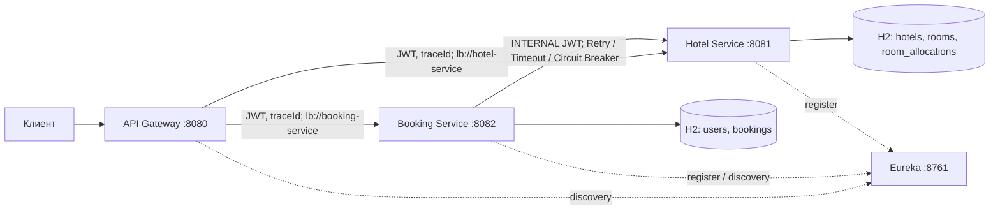

# MEPhI Hotel Booking

REST API бронирования отелей: Java 17+, Spring Boot 3.5.14, Spring Cloud 2025.0.0,
Spring Security Resource Server, JPA/Hibernate, две независимые in-memory H2.
Maven управляет версиями через BOM; ручная установка библиотек не требуется.

## Архитектура



| Модуль | Назначение | Документация |
|---|---|---|
| `api-gateway` | Динамическая маршрутизация, JWT, запрет внутренних методов, traceId | [Gateway](api-gateway/README.md) |
| `booking-service` | Пользователи, личные брони, оркестратор саги, восстановление | [Booking](booking-service/README.md) |
| `hotel-service` | Каталог, атомарное резервирование, рекомендации и аналитика | [Hotel](hotel-service/README.md) |
| `eureka-server` | Реестр сервисов | [Eureka](eureka-server/README.md) |
| `common` | DTO, JWT, ошибки, MDC, согласованные demo fixtures | [Common](common/README.md) |

Подробности: [схема БД](docs/database.md), [решения ADR](docs/adr/),
[матрица критериев](docs/criteria.md), [проверка и ограничения окружения](docs/verification.md).

## Быстрый запуск

Нужны JDK 17 или 21 и Maven 3.9+. В CI используется JDK 21. Проверка:

```bash
java -version
mvn -s .mvn/settings.xml clean verify
./scripts/run-local.sh
```

Скрипт запускает четыре исполняемых `*-exec.jar`, пишет логи в `logs/` и завершает
свои процессы по Ctrl+C. Для раздельного запуска в четырёх терминалах:

```bash
java -jar eureka-server/target/eureka-server-1.0.0-SNAPSHOT-exec.jar
java -jar hotel-service/target/hotel-service-1.0.0-SNAPSHOT-exec.jar
java -jar booking-service/target/booking-service-1.0.0-SNAPSHOT-exec.jar
java -jar api-gateway/target/api-gateway-1.0.0-SNAPSHOT-exec.jar
```

Альтернатива с Docker Compose:

```bash
cp .env.example .env
# При необходимости замените JWT_SECRET в .env; одинаковый секрет нужен всем сервисам.
docker compose up --build --wait
# Завершение:
docker compose down
```

Первой сборке нужен доступ к Maven Central и Docker registry. `.mvn/settings.xml`
позволяет использовать публичный Maven Central независимо от пользовательских mirrors.
В корпоративной среде можно убрать `-s` и использовать собственные настройки Maven.

Eureka: <http://localhost:8761>. Проверка здоровья: `/actuator/health` на каждом порту.
После старта дождитесь появления `BOOKING-SERVICE`, `HOTEL-SERVICE`, `API-GATEWAY`
в Eureka. Первичная регистрация и обновление кеша discovery могут занять около минуты;
до этого Gateway может отвечать 503.

## Демонстрационные данные

Предзаполнение включено по умолчанию (`DEMO_SEED=true`). Для пустых БД установите
`DEMO_SEED=false` одновременно в Booking и Hotel. Guard для блокировок создаётся всегда.
Данные живут до остановки процесса: при перезапуске H2 создаётся заново.
Для согласованного сброса демонстрации перезапускайте оба бизнес-сервиса.

| Логин | Пароль демонстрации | Роль |
|---|---|---|
| `admin` | `Admin123!` | ADMIN |
| `alice` | `Alice123!` | USER |
| `bob` | `Bob12345!` | USER |

Два отеля, семь номеров, номер 5 на ремонте. У номера 1 `timesBooked=2`,
у номера 2 — `1`, у остальных — `0`. Есть три согласованные CONFIRMED-брони
и одна CANCELLED в истории Alice. Даты рассчитываются от текущего дня UTC:
номера 1 и 2 заняты на `[сегодня+10, сегодня+12)`, номер 1 также на
`[сегодня+20, сегодня+22)`. Общий `DemoData` задаёт одинаковые bookingId и даты
в обеих БД без HTTP-зависимости порядка запуска. Полные детали — в [схеме](docs/database.md).

Пароли хешируются BCrypt. JWT действует один час, содержит `sub=userId`, `roles`,
`iss=mephi-booking`. Внутренний JWT имеет роль INTERNAL и срок 5 минут.
Демонстрационный секрет и аккаунты предназначены для локального учебного запуска.

## Пример через Gateway

Нужны `curl` и Python 3. Автоподбор при `autoSelect=true` игнорирует `roomId`;
необязательный `hotelId` ограничивает выбор одним отелем.

```bash
TOKEN=$(curl -fsS http://localhost:8080/user/auth \
  -H 'Content-Type: application/json' \
  -d '{"username":"alice","password":"Alice123!"}' \
  | python3 -c 'import json,sys; print(json.load(sys.stdin)["accessToken"])')

curl -fsS http://localhost:8080/api/hotels -H "Authorization: Bearer $TOKEN"

START=$(python3 -c 'from datetime import datetime,timedelta,timezone; print((datetime.now(timezone.utc).date()+timedelta(days=30)).isoformat())')
END=$(python3 -c 'from datetime import datetime,timedelta,timezone; print((datetime.now(timezone.utc).date()+timedelta(days=32)).isoformat())')
REQUEST_ID=$(python3 -c 'import uuid; print(uuid.uuid4())')

curl -fsS "http://localhost:8080/api/rooms/recommend?hotelId=1&startDate=$START&endDate=$END" \
  -H "Authorization: Bearer $TOKEN"

curl -sS http://localhost:8080/api/bookings \
  -H "Authorization: Bearer $TOKEN" -H 'Content-Type: application/json' \
  -H 'X-Trace-Id: demo-booking-1' \
  -d "{\"requestId\":\"$REQUEST_ID\",\"autoSelect\":true,\"hotelId\":1,\"startDate\":\"$START\",\"endDate\":\"$END\"}"

curl -fsS 'http://localhost:8080/api/bookings?page=0&size=10' \
  -H "Authorization: Bearer $TOKEN"

# Подставьте id из ответа:
# curl -X DELETE http://localhost:8080/api/bookings/<id> -H "Authorization: Bearer $TOKEN"
```

Повторите POST с тем же `REQUEST_ID` и телом: вернётся та же бронь, счётчик не увеличится.
Изменение существенных полей при том же ключе вернёт 409. Ключ уникален в пределах
пользователя. Состояния ответа: 201 CONFIRMED, 202 PENDING при уже выполняющемся
дубликате, 409 при недоступном номере, 503 при сбое Hotel. Ошибки содержат единый
`ErrorDto`; у неуспешной саги в `fields.bookingId` находится id CANCELLED-брони,
а `fields.compensationPending` показывает необходимость фонового отката.
Повтор создания уже отменённой пользователем брони возвращает существующую CANCELLED
с 200 и никогда не создаёт её заново. Для новой брони нужен новый requestId.

## Публичные эндпойнты

Все перечисленные пути доступны через Gateway. USER и ADMIN могут выполнять личные
операции; история и доступ по id всегда ограничены владельцем, включая ADMIN.
Списки имеют `content`, `page`, `size`, `totalElements`, `totalPages`;
`page>=0`, `1<=size<=100`.

| Метод и путь | Доступ | Описание |
|---|---|---|
| `POST /user/register` | публичный | Регистрация USER, JWT |
| `POST /user/auth` | публичный | Вход, JWT |
| `GET /user`, `GET /user/{id}` | ADMIN | Список и пользователь |
| `POST /user` | ADMIN | Создать пользователя с ролью |
| `PATCH /user/{id}` | ADMIN | username/password/role |
| `DELETE /user/{id}` | ADMIN | Отключить пользователя с сохранением истории |
| `PATCH /user?id=...`, `DELETE /user?id=...` | ADMIN | Варианты путей из ТЗ |
| `POST /api/bookings` | USER / ADMIN | Создание, requestId UUID обязателен |
| `GET /api/bookings` | USER / ADMIN | Личная история с пагинацией |
| `GET /api/bookings/{id}` | владелец | Бронь |
| `DELETE /api/bookings/{id}` | владелец | Идемпотентная отмена и компенсация |
| `GET /api/bookings/recommend` | USER / ADMIN | Рекомендации через Booking |
| `GET /api/hotels?name=...` | USER / ADMIN | Поиск названия без учёта регистра, пагинация |
| `GET /api/hotels/{id}` | USER / ADMIN | Отель |
| `POST /api/hotels` | ADMIN | `{name,address}` |
| `PUT /api/hotels/{id}` | ADMIN | Обновить отель |
| `DELETE /api/hotels/{id}` | ADMIN | Удалить отель без номеров |
| `GET /api/rooms` | USER / ADMIN | Операционно доступные номера; hotelId, даты, пагинация |
| `GET /api/rooms/recommend` | USER / ADMIN | Свободные номера по `(timesBooked,id)` |
| `GET /api/rooms/{id}` | USER / ADMIN | Конкретный номер, включая состояние ремонта |
| `POST /api/rooms` | ADMIN | `{hotelId,number,available}` |
| `PUT /api/rooms/{id}` | ADMIN | Обновить номер; смена отеля запрещена |
| `DELETE /api/rooms/{id}` | ADMIN | Удалить номер без истории аллокаций |
| `GET /api/rooms/statistics` | ADMIN | Аналитика по периоду; hotelId необязателен |
| `GET /api/hotels/statistics` | ADMIN | Тот же отчёт |

Также поддерживаются пути ТЗ `POST /booking`, `GET /bookings`, `GET/DELETE /booking/{id}`,
`GET /bookings/recommend`. Для рекомендаций и статистики обязательны `startDate`,
`endDate`; для `/api/rooms` обе даты либо заданы, либо отсутствуют. Без дат список
показывает операционную доступность, без обещания свободного слота на конкретный период.
Для создания дата заезда не в прошлом, дата выезда строго позже, длительность <=365 ночей.

Аналитика содержит число номеров, число операционно доступных номеров, число броней
в периоде, занятые ночи с обрезкой по границам периода, occupancyRate по номеру и отелю.
Знаменатель общей загрузки — все номера × ночи; операционная доступность выводится
отдельно. Интервалы полуоткрытые: день выезда можно использовать для следующего заезда.

## Внутреннее API Hotel

Только прямое обращение к Hotel с INTERNAL JWT. Gateway запрещает эти пути для всех ролей.
Обычные USER/ADMIN не имеют к ним доступа даже при прямом обращении.

| Метод | Тело | Назначение |
|---|---|---|
| `POST /api/rooms/{id}/confirm-availability` | `{bookingId,startDate,endDate}` | Проверка и резервирование |
| `POST /api/rooms/allocate?hotelId=...` | то же | Атомарный выбор наименее загруженного свободного номера |
| `POST /api/rooms/{id}/release` | `{bookingId}` | Компенсация известного номера |
| `POST /api/rooms/release` | `{bookingId}` | Компенсация, когда ответ автоподбора потерян и roomId неизвестен |

## Согласованность и многопоточность

1. Booking сохраняет PENDING в отдельной локальной транзакции; `(user_id,request_id)`
   защищён unique constraint. Блокировка пользователя сериализует создание одного ключа.
2. В отдельной транзакции worker получает lease и уникальный processToken.
3. HTTP-вызов Hotel выполняется **вне транзакции Booking**. Hotel в своей транзакции
   блокирует единственную строку `allocation_guard`, выбирает номер по свежей статистике,
   проверяет пересечение дат и сохраняет аллокацию. Сетевых вызовов под этой блокировкой нет.
4. При успехе Booking фиксирует CONFIRMED, только если владеет processToken.
   При ошибке — CANCELLED и `compensationPending=true` в одной транзакции.
5. Компенсация всегда отправляет release, включая неоднозначный тайм-аут. При сбое release
   флаг сохраняется. Recovery раз в секунду повторяет компенсации и подхватывает PENDING
   с истёкшим lease. Повторные операции идемпотентны.

В Hotel `bookingId` — первичный ключ аллокации. Release создаёт RELEASED-запись даже
до прихода confirm. Такая tombstone запрещает запоздалому confirm занять номер.
При отмене уменьшается `timesBooked` ровно один раз: счётчик отражает все успешно
выделенные и не отменённые брони, включая уже прошедшие периоды. Поле `available`
отражает ремонт/вывод из эксплуатации и не заменяет проверку занятости по датам.

Стандартные сетевые параметры: connect timeout 500 мс, read timeout 1500 мс,
3 попытки, backoff 150/300 мс. Spring Retry повторяет только технические ошибки;
404/409 не повторяются. Circuit Breaker открывается после 5 последовательных
неуспешных операций, через 5 секунд допускает одну HALF_OPEN-пробу. Бизнес-конфликт
считается успешным обращением к доступному сервису. У confirm и release независимые
Circuit Breaker, поэтому сбой подтверждений не блокирует компенсацию.

Настройки: `hotel.connect-timeout-ms`, `hotel.read-timeout-ms`, `hotel.retry-delay-ms`,
`hotel.breaker-wait-ms`, `booking.lease-seconds` (30), `booking.recovery.delay-ms` (1000).
Lease должен превышать полный бюджет попыток с backoff. Выбор одной блокировки
осознанно отдаёт приоритет корректности и равномерности; масштабирование описано в ADR.

## Безопасность, ошибки и трассировка

Gateway, Booking и Hotel самостоятельно валидируют подпись HS256, issuer и срок JWT.
На контроллерах backend действует `@PreAuthorize`; CSRF отключён для stateless Bearer API.
Нет сессий, H2 console выключена. Пароли и JWT не логируются. Неизвестная или чужая бронь
возвращает 404, отсутствующий/повреждённый JWT — 401, недостаточная роль — 403.
Удаление пользователя логическое; старый токен не позволяет ему создавать брони.
Уже выпущенные JWT сохраняют свои роли в Hotel до истечения часа; централизованного
отзыва токенов в этом учебном проекте нет.

Единый `ErrorDto`: timestamp, status, code, message, path, traceId, fields.
Технические подробности исключений не выдаются клиенту. `X-Trace-Id` принимается
только из 1–64 безопасных символов; иначе генерируется UUID. Он возвращается клиенту
и передаётся в Hotel. JSON-логи содержат traceId; шаги саги также имеют bookingId,
включая фоновые компенсации.

## OpenAPI

- Hotel Swagger UI: <http://localhost:8081/swagger-ui.html>
- Booking Swagger UI: <http://localhost:8082/swagger-ui.html>
- JSON: `/v3/api-docs` на backend; `/docs/hotel`, `/docs/booking` через Gateway.

В Swagger нажмите Authorize и вставьте JWT. Внутренние методы также описаны,
но требуют сервисную роль. Регистрация и авторизация не требуют Bearer.

## Проверка

```bash
mvn -s .mvn/settings.xml clean verify
# Только бизнес-сервисы, с зависимыми модулями:
mvn -s .mvn/settings.xml -pl booking-service -am test
```

JUnit, MockMvc и WebTestClient покрывают авторизацию, CRUD, валидацию, пагинацию,
конкурентные явные и автоматические брони, идемпотентность, компенсацию,
потерю ответа, тайм-ауты, восстановление саги, отказ компенсации, поздний confirm.
В интеграции Booking/Hotel поднимаются два отдельных Spring-контекста и две базы;
транспорт MockMvc проверяет реальные контроллеры, Security и JPA без открытых портов.
HTTP-адаптер отдельно проверяется через MockRestServiceServer с реальным RestClient
и Spring Retry. В тестах нет зависимости от работающих Eureka, Docker и внешних API.

Maven verify запускает Checkstyle; стиль задан `.editorconfig`, `.clang-format`,
`checkstyle.xml`. GitHub Actions собирает весь reactor и сохраняет отчёты JUnit.
Состояние фактически выполненных локальных проверок указано в [verification.md](docs/verification.md).

## Границы учебной реализации

In-memory H2 по условию не обеспечивает сохранность после перезапуска процесса.
Recovery восстанавливает прерванные worker-операции, пока сохранена база. Для восстановления
после перезапуска нужны постоянные отдельные БД; алгоритм lease/компенсации остаётся тем же.
После независимого перезапуска только одного backend согласованность старых данных
не гарантируется. Нет глобальных XA-транзакций, ожидания таймера автоматического
истечения подтверждённой аллокации и JVM-lock, подменяющих блокировку БД.
Registry предназначен для доверенной сети; Docker публикует demo-порты только на localhost.
